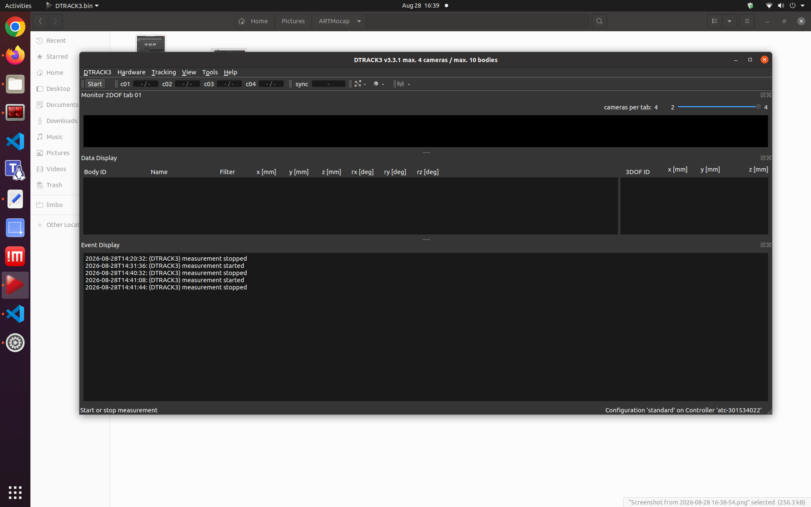
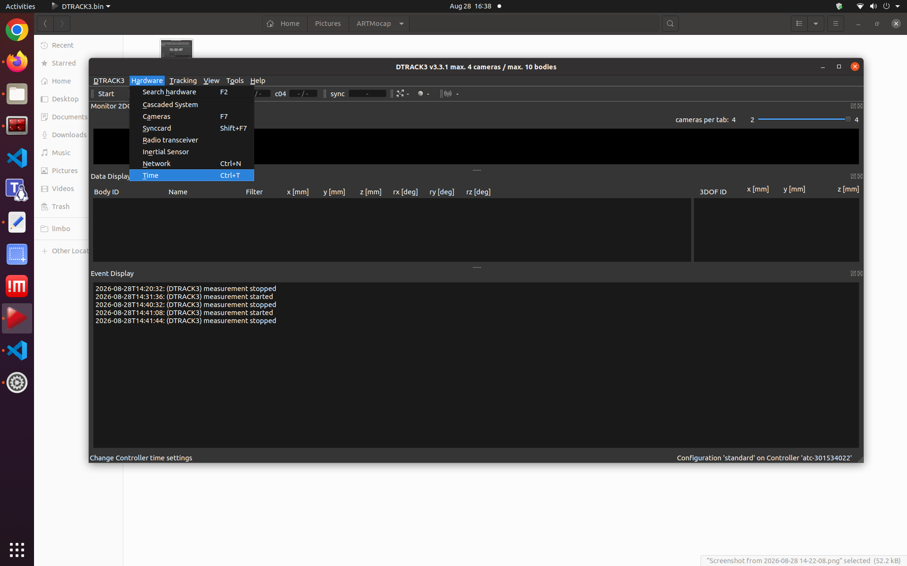
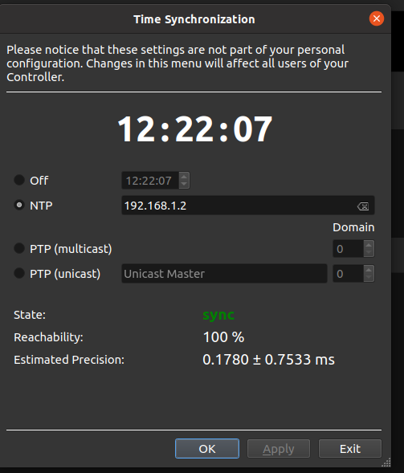

# DTrack Publisher

`dtrack_publisher` is a ROS 2 package that receives rigid-body tracking data
from an ART DTrack system over UDP and publishes each detected body as a pose
and a path.

```text
DTrack controller ── UDP (`6d` + `ts2`/`ts`) ──> dtrack_multi_body_node
                                                ├── PoseStamped per body
                                                ├── Path per body
                                                └── parent_frame → frame_id TF
```

The node keeps the calibrated DTrack coordinate system, converts positions
from millimetres to metres, and converts DTrack rotation matrices into
normalized quaternions. It uses the bundled official DTrackSDK 2.9.0 for UDP
reception and parsing. DTrack measurement timestamps are preserved when the
controller and ROS computer are synchronized.

## Demo

The video shows a tracked object together with its live representation in
RViz.

<video src="docs/media/MoCapDemo.mp4" controls width="100%">
  Your Markdown viewer cannot play this video.
  <a href="docs/media/MoCapDemo.mp4">Open or download the MoCap demo video.</a>
</video>

[Open or download `MoCapDemo.mp4`](docs/media/MoCapDemo.mp4) if the video does
not play directly in the README.

## Requirements

- An ART DTrack system with at least one configured rigid body
- DTrack software installed on the controller computer or operator computer
- A Linux computer with ROS 2 and `colcon`
- An Ethernet connection between the DTrack controller and the ROS computer
- `chrony` when DTrack measurement timestamps must match the ROS system clock

This guide uses ROS 2 Jazzy and the following network as an example:

| Setting | Example | Purpose |
| --- | --- | --- |
| ROS computer address | `192.168.1.2` | UDP receiver and NTP server |
| MoCap subnet | `192.168.1.0/24` | Network shared by DTrack and ROS |
| DTrack UDP destination port | `5000` | Must match `udp_port` in the package configuration |
| NTP port | UDP `123` | Used by DTrack to synchronize its clock |

Replace these values with addresses that match your network. The ROS computer
needs a static address on the DTrack network. You can inspect its configured
interfaces with:

```bash
ip -brief address
```

## Configure DTrack output

Menu names can differ slightly between DTrack versions, but the required data
is the same:

1. Connect the controller and ROS computer to the same Ethernet network.
2. Start the controller and open the DTrack software.
3. Configure and calibrate the rigid bodies that should be published.
4. Set the DTrack output destination to the ROS computer's static IP address.
5. Set the UDP port to the value configured for this package (`5000` by
   default).
6. Enable `6d` rigid-body output and preferably the extended `ts2` timestamp.
   The legacy `ts` format remains supported as a fallback.
7. Start the measurement.



If UFW is active on the ROS computer, allow DTrack data from the MoCap subnet:

```bash
sudo ufw allow from 192.168.1.0/24 to any port 5000 proto udp
```

Adjust the subnet and port before running the command.

## Synchronize time with Chrony

DTrack's preferred `ts2` value is an absolute Unix timestamp. The legacy `ts`
value is the number of seconds since UTC midnight. For either format, the
DTrack controller and ROS computer should use a shared time source. In this
setup, the ROS computer runs Chrony as an NTP server for the controller.

### 1. Install and start Chrony

On Ubuntu or Debian-based systems:

```bash
sudo apt update
sudo apt install chrony
sudo systemctl enable --now chrony
```

### 2. Allow the DTrack network

Open the Chrony configuration:

```bash
sudoedit /etc/chrony/chrony.conf
```

Add an `allow` rule for the MoCap subnet:

```text
allow 192.168.1.0/24
```

This turns Chrony into an NTP server for clients in that subnet. Do not use an
unrestricted `allow` rule on a network that is not trusted.

If the MoCap network is isolated and the ROS computer cannot reach an external
NTP source, also add:

```text
local stratum 10
```

This lets the computer provide a consistent local time base while it is
offline. It keeps the devices synchronized with each other, but it does not
provide an accurate external UTC reference. Omit this line when an external or
institutional NTP source is required.

Restart Chrony after editing the file:

```bash
sudo systemctl restart chrony
sudo systemctl status chrony --no-pager
```

If UFW is active, allow NTP requests only from the MoCap subnet:

```bash
sudo ufw allow from 192.168.1.0/24 to any port 123 proto udp
```

### 3. Configure the DTrack controller

In DTrack, open **Hardware → Time**.



Select **NTP**, enter the ROS computer's address as the NTP server, and apply
the settings. In this example, the server is `192.168.1.2`. Wait until DTrack
reports the state as `sync`.



### 4. Verify synchronization

Check the ROS computer's synchronization and time sources:

```bash
chronyc tracking
chronyc sources -v
```

After DTrack has sent NTP requests, verify that the controller appears as a
client:

```bash
sudo chronyc clients
```

See the official [Chrony configuration reference](https://chrony-project.org/doc/latest/chrony.conf.html)
and [Ubuntu Chrony server guide](https://documentation.ubuntu.com/server/how-to/networking/serve-ntp-with-chrony/index.html)
for advanced configurations.

## Build and run

Place this package in the `src` directory of a ROS 2 workspace. The following
commands use ROS 2 Jazzy and `~/ros2_ws`; change the two variables if your setup
is different:

```bash
ROS_DISTRO_NAME=jazzy
ROS_WS=~/ros2_ws

source "/opt/ros/${ROS_DISTRO_NAME}/setup.bash"
cd "${ROS_WS}"
colcon build --packages-select dtrack_publisher
source install/setup.bash
ros2 launch dtrack_publisher dtrack_multi_body.launch.py
```

The package contains the required DTrackSDK sources, so no separate SDK
installation or network download is needed during the build. The node listens
on all local network interfaces. It creates publishers only after a body first
appears as tracked in a valid DTrack packet.

## Configuration

Runtime defaults are stored in
[`config/dtrack_multi_body.yaml`](config/dtrack_multi_body.yaml):

| Parameter | Default | Description |
| --- | --- | --- |
| `udp_port` | `5000` | Local UDP port in the range 1–65535 |
| `multicast_ip` | empty | Optional IPv4 multicast group; empty selects unicast listening |
| `frame_id` | `odom_mocap` | Frame assigned to published poses and paths |
| `parent_frame` | `odom` | Parent of the published identity transform |
| `max_path_length` | `500` | Maximum number of retained poses; must be at least 1 |

Edit the source configuration before building the package. Rebuild and source
the workspace after changing it. The DTrack destination port and `udp_port`
must be identical. For multicast, configure the same group address in DTrack
and `multicast_ip`.

## ROS interfaces

### Topics

Each detected rigid body gets two topics:

| Topic | Type | Description |
| --- | --- | --- |
| `dtrack/body_<n>/pose` | `geometry_msgs/msg/PoseStamped` | Latest measured pose |
| `dtrack/body_<n>/path` | `nav_msgs/msg/Path` | Recent poses in chronological order |

DTrack body IDs are zero-based, while topic numbers are one-based. For example,
raw DTrack body ID `0` is published under `/dtrack/body_1`.
The names are relative: at the root namespace they resolve with a leading `/`;
under `/mocap`, for example, they become `/mocap/dtrack/body_1/...` and can be
remapped normally.

The pose message contains:

- `header.stamp`: the DTrack measurement time, or local reception time as a
  fallback
- `header.frame_id`: the configured `frame_id`
- `pose.position`: x, y, and z in metres
- `pose.orientation`: a normalized quaternion in x, y, z, w order

The path uses the same frame and timestamp. It contains at most
`max_path_length` poses.

### Tracking quality

DTrack marks an untracked body with a negative quality value. Such bodies do
not produce pose or path messages. On tracking loss, the stored path for that
body is cleared; the first valid pose after reacquisition starts a new path
segment. No publishers are created for bodies that have never been tracked.

### Transform

For every received packet, the node broadcasts an identity transform from
`parent_frame` to `frame_id`. With the default configuration, this is:

```text
odom → odom_mocap
```

Choose frame names that do not conflict with another TF publisher in your ROS
system.

### Timestamps

The node selects timestamps in this order:

1. `ts2`: Unix seconds plus microseconds are used directly.
2. `ts`: seconds since `00:00 UTC` are combined with the nearest UTC date;
   packets around midnight can therefore resolve to the previous or next day.
3. If neither timestamp is valid, the node emits a throttled warning and uses
   local reception time.

Pose, path, and TF messages all use the selected timestamp.

## Verify the data

List the DTrack topics and inspect body 1:

```bash
ros2 topic list | grep dtrack
ros2 topic echo /dtrack/body_1/pose
ros2 topic hz /dtrack/body_1/pose
```

Inspect the path and default transform:

```bash
ros2 topic echo /dtrack/body_1/path
ros2 run tf2_ros tf2_echo odom odom_mocap
```

To check whether UDP packets reach the ROS computer:

```bash
sudo tcpdump -ni any udp port 5000
```

## Troubleshooting

| Problem | Checks |
| --- | --- |
| No DTrack topics appear | Start the DTrack measurement; verify the destination IP, UDP port, `6d` output, network route, and firewall. |
| The node cannot bind the UDP port | Check for another listener with `sudo ss -ulpn \| grep ':5000'`, or select an unused port in both DTrack and the YAML file. |
| `no valid ts or ts2 timestamp` warning | Enable `ts2` (preferred) or `ts` output in DTrack and restart the measurement. |
| Multicast listener fails at startup | Verify that `multicast_ip` is an IPv4 multicast address in `224.0.0.0/4` and that the host has a route for the selected interface. |
| Paths stop and restart | DTrack reported negative quality; this intentionally clears the affected body's previous path segment. |
| DTrack does not show `sync` | Verify the NTP server address, Chrony `allow` subnet, UDP port 123, firewall, and `sudo chronyc clients`. |
| Devices agree but UTC is incorrect | An isolated `local stratum` setup has no external UTC reference; connect Chrony to a trusted upstream source. |
| Pose time differs by a day near midnight | Confirm that the ROS computer's date and UTC time are correct with `chronyc tracking`. |
| TF warnings report multiple authorities | Change `parent_frame` or `frame_id`, or disable the conflicting transform publisher. |

## License

The ROS package's own code is licensed under the [MIT License](LICENSE).
DTrackSDK 2.9.0 is bundled unchanged under the BSD 3-Clause License; see
[`third_party/DTrackSDK/license.txt`](third_party/DTrackSDK/license.txt). Both
license files are installed with the package.
